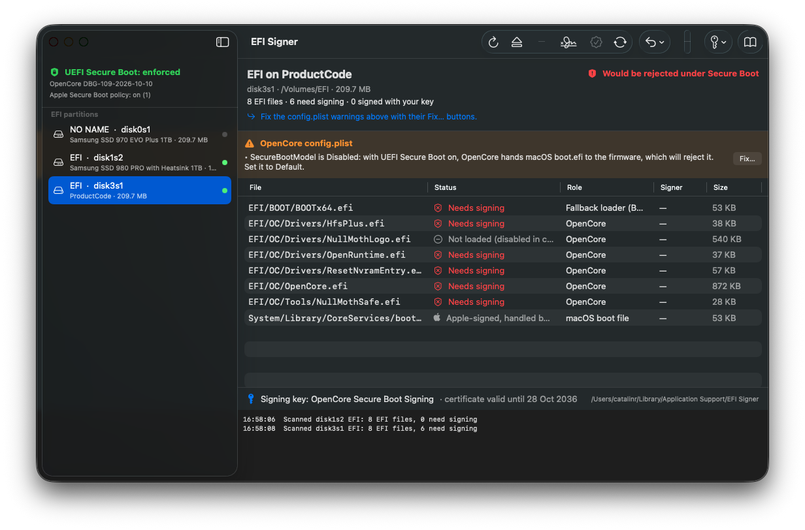
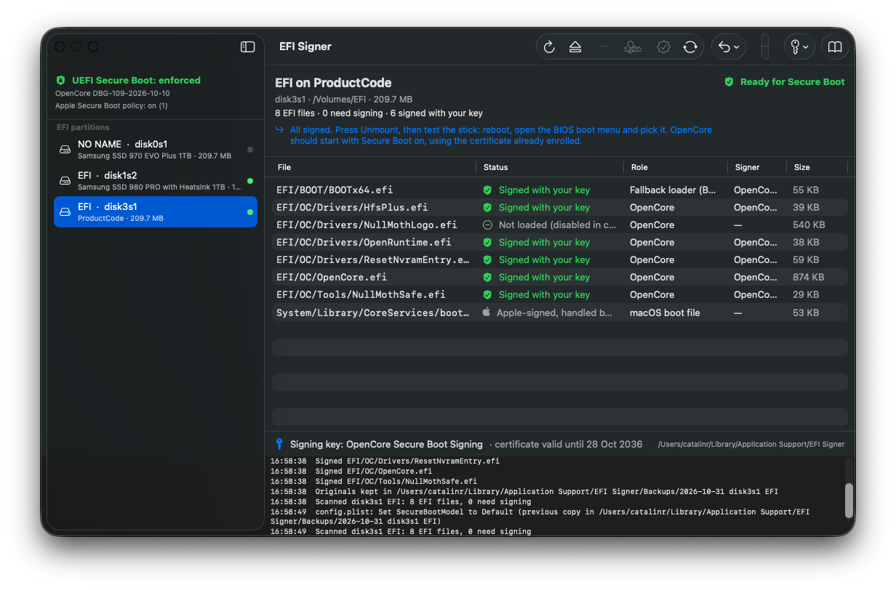

# EFI Signer

Keep UEFI Secure Boot **on** with OpenCore. EFI Signer finds every EFI partition on your Mac,
shows which `.efi` files the firmware would reject, and signs them with your own key.
Enrol the matching certificate in the BIOS once and the Hackintosh boots with Secure Boot enabled.

| Before | After |
|---|---|
|  |  |

## Why

OpenCore, its drivers and tools ship unsigned, so a PC with Secure Boot enabled refuses to load
them. The usual answer is to switch Secure Boot off. The other answer is to sign them yourself:
the firmware trusts any certificate in its `db`, including one you made.

## Use

1. **Key → Generate new key.** Creates an RSA key and a self-signed certificate on your Mac
   (or **Import** an existing `db.key` / `db.crt`).
2. **Select your boot disk's EFI partition** in the sidebar. Press **Mount** if it is grey.
3. **Fix any config.plist warning** with its **Fix…** button. `SecureBootModel` must not be
   `Disabled`, otherwise OpenCore hands Apple's `boot.efi` to the firmware, which cannot verify it.
4. **Sign needed.** Every file the firmware would reject is signed in place; originals are kept
   in `~/Library/Application Support/EFI Signer/Backups`. **Revert** in the toolbar puts them
   back (and restores config.plist to the copy saved before a Fix…).
5. **Key → Export certificate for BIOS** onto a FAT32 USB stick, then in the BIOS: Secure Boot →
   Custom / Key Management → **db → Append** `db.cer`. Keep Microsoft's entries (they sign your
   GPU's option ROM and Windows). Enable Secure Boot, reboot.

Official vendor pages for the key menu (always under Secure Boot; it unlocks in *Custom* mode):
[ASUS](https://www.asus.com/support/faq/1049829/) ·
[ASRock](https://www.asrock.com/support/faq.asp?id=531) ·
[Gigabyte](https://www.gigabyte.com/Support/Consumer/Faq/4395) ·
[MSI (BIOS guide, PDF)](https://download-2.msi.com/archive/mnu_exe/mb/AMDAM5BIOS.pdf) ·
[Dell](https://www.dell.com/support/kbdoc/en-us/000368610/how-to-update-secure-boot-active-database-from-bios) ·
[Lenovo](https://pubs.lenovo.com/uefi_edge_v2/secure_boot_custom_policy) ·
[HP business PCs (PDF)](https://ftp.hp.com/pub/caps-softpaq/cmit/whitepapers/HPBIOSSetup.pdf)

After an OpenCore update, press **Sign needed** again. Other disks and installer sticks signed
with the same key boot too; no BIOS visit needed. The header always tells you the next step,
and the built-in guide (toolbar book icon, ⌘?) has the details.

## Status column

| Status | Meaning |
|---|---|
| Needs signing | Unsigned; the firmware will refuse it |
| Signed with your key | Good |
| Signed (other key) | Microsoft etc. Fine while that CA is in the BIOS db |
| Signature broken | Changed after signing; re-sign |
| Not loaded | Disabled in config.plist, Apple updater files, or Apple-signed files OpenCore verifies itself |

## Build

Requires Xcode 26 / Swift 6 on macOS 13 or newer. No other dependencies.

```bash
./scripts/build-app.sh            # → build/EFI Signer.app
swift build --product efisign     # command-line twin: hash, inspect, sign, scan, fix-config, firmware
```

## How it works

The signer implements Authenticode for PE/COFF in Swift on top of Security.framework and
CryptoKit: strip any existing signature, pad to 8 bytes, hash per the PE Authenticode rules, build
a PKCS#7 `SignedData` with the certificate embedded, append the `WIN_CERTIFICATE` table, recompute
the checksum. Every result is verified in memory before the file on disk is replaced. The firmware
state in the sidebar is read from the `SecureBoot` / `SetupMode` NVRAM variables.

## License

MIT
